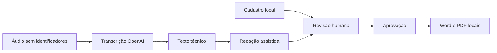

# Redator de Relatórios Técnicos

Aplicação local para transformar avaliações de manutenção de equipamentos em relatórios revisáveis.
O profissional registra o que observou, os procedimentos, os resultados e sua conclusão. A IA auxilia
na redação e na organização da fundamentação já informada. **O diagnóstico técnico pertence ao
profissional; a revisão e a aprovação humanas são obrigatórias.**

## Problema resolvido

Anotações de bancada e ditados costumam exigir tempo para virar um documento claro. O aplicativo
reúne cadastro, relato, revisão e exportação, preservando a distinção entre hipótese, teste realizado,
resultado observado e reparo apenas recomendado. Não consulta manuais nem produz diagnóstico autônomo.

## Funcionalidades

- Cadastro de solicitante, setor e vários equipamentos, com tipo, lado opcional, modelo e série.
- Avaliação única por texto, gravação no navegador ou arquivo de áudio.
- Transcrição pela OpenAI; redação nos formatos Objetivo e Detalhado.
- Ajuda opcional para organizar o relato e esclarecer até três lacunas.
- Demonstração sem IA para texto, com exemplos inteiramente fictícios.
- Revisão editável, aprovação explícita e invalidação da aprovação após alterações.
- Exportação DOCX local; PDF opcional pelo Microsoft Word instalado no Windows.

## Tecnologias e fluxo

Python 3.12, Streamlit, SDK OpenAI, python-docx, python-dotenv, PyAV e pytest.
O cadastro fica separado da entrada técnica enviada à IA. A geração usa Responses com saída
estruturada, `store=False`, sem ferramentas, pesquisa ou histórico remoto. O DOCX é montado localmente.



## Requisitos

Python 3.12 de 64 bits e navegador moderno. A demonstração textual e o DOCX funcionam sem chave
ou internet após instalar as dependências. Redação e transcrição remotas exigem conexão, chave
OpenAI e acesso aos modelos configurados; podem gerar cobrança. Microfone requer permissão do
navegador. Para PDF automático: Windows e Microsoft Word instalado e ativado. Sem Word, baixe o
DOCX e converta com uma ferramenta local de sua escolha.

## Instalação local

Abra o terminal na pasta deste projeto. No Windows/PowerShell:

```powershell
python -m venv .venv
.\.venv\Scripts\python.exe -m pip install -r requirements-runtime-lock.txt
.\.venv\Scripts\python.exe -m streamlit run app.py
```

Acesse `http://127.0.0.1:8511`. Encerre com Ctrl+C no terminal. Não exponha a porta à rede.
Em outros sistemas, use `.venv/bin/python` nos comandos; o PDF automático permanece restrito ao Windows.

## Configuração segura da OpenAI

Copie `.env.example` para `.env` e preencha `OPENAI_API_KEY` apenas localmente. Escolha em
`OPENAI_MODEL` um modelo disponível na sua conta que suporte Responses e Structured Outputs.
O valor de exemplo não garante disponibilidade na sua conta; ajuste-o conforme seu acesso.
Reinicie o aplicativo após configurar. Não coloque credenciais em código, capturas, documentos ou Git.
O áudio usa `gpt-transcribe` independentemente do modelo de redação; disponibilidade e custos precisam
ser conferidos na conta antes de uso real. Nenhuma chamada real é necessária para a demonstração textual.

Para personalizar cidade, responsável e cargo, copie `config/profile.example.json` para
`local/profile.json`. Esse arquivo fica fora do versionamento. O modelo Word neutro é construído
em `local/template-neutro.docx` no primeiro uso. Não distribua templates institucionais ou de terceiros.

## Demonstração com dados fictícios

1. Selecione **Demonstração local** e clique em **Carregar exemplo fictício**.
2. Confira o módulo eletrônico e o carregador sintéticos. Edite a avaliação se desejar.
3. Clique em **Gerar relatório para revisão**. Nesse modo, o relato é preservado; não há redação por IA.
4. Revise o texto e o cadastro. Marque a aprovação e prepare os documentos revisados.
5. Para testar só o DOCX, desmarque a opção de PDF.

**A transcrição sempre envia o áudio à OpenAI, mesmo quando a redação está em Demonstração local.**
Use gravação própria com conteúdo inteiramente fictício. Não utilize vozes ou relatos de terceiros.

## Privacidade e limitações

O aplicativo não mantém banco de dados. O trabalho fica na sessão; baixe os documentos antes de
encerrar. O cadastro não é anexado à redação, mas tipos e texto livre podem revelar informações.
A detecção automática de identificadores é parcial e pode produzir falsos positivos e negativos.
Remova nomes, séries, modelos, endereços e informações confidenciais do relato antes do envio.

O áudio original é enviado ao provedor sem anonimização prévia, com nome de arquivo genérico.
Limites: 20 MB e dez minutos por áudio; 10.000 caracteres por transcrição e 20.000 no relato combinado.
Não dite identificadores. `store=False` se aplica à redação e não significa retenção zero pelo provedor.
Documentos, nomes de download e arquivos locais ainda podem conter o cadastro e exigem cuidado.

A IA pode omitir, reinterpretar ou acrescentar fatos. Confira cada equipamento, número, negação,
componente, resultado e recomendação. A aplicação não pesquisa fabricantes, não comprova causas,
não certifica reparos e não substitui normas, manuais autorizados ou conhecimento profissional.

## Testes e revisão de publicação

```powershell
.\.venv\Scripts\python.exe -m pip install -r requirements-dev-lock.txt
.\.venv\Scripts\python.exe -B -m pytest -q
.\.venv\Scripts\python.exe -B scripts/audit_public.py
```

Os testes usam dados sintéticos, respostas simuladas e transporte HTTP em memória. A suíte bloqueia
rede externa e limpa a chave do ambiente. Não há scripts de demonstração que façam chamadas pagas.
Validação local: **139 testes aprovados**, servidor em loopback e DOCX/PDF sintéticos verificados.
Veja [resultados da validação](docs/VALIDACAO.md), [auditoria](docs/AUDITORIA.md), [privacidade](docs/PRIVACIDADE.md) e
[dependências e titularidade](docs/DEPENDENCIAS.md).

## Situação de publicação e licença

Projeto de portfólio com histórico Git independente. O responsável confirmou autorização para
envio a um repositório privado. A disponibilização pública e a licença do código próprio ainda
dependem de revisão específica; nenhuma licença de código aberto foi atribuída.
Dependências mantêm suas próprias licenças.
Não há documentos de fabricante, logotipos, laudos reais ou templates institucionais neste projeto.
